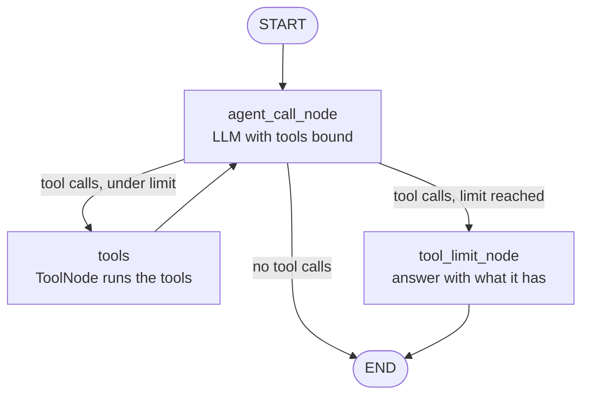

# Multi-Tool Autonomous AI Agent

An autonomous AI agent that solves multi-step problems by choosing and chaining tools on its own: **real-time web search**, a **safe math calculator** and a **local file reader**. It shows its full reasoning chain (**Thought → Action → Observation → Final Answer**) in a Gradio chat UI and has per-session memory.

> Datheon Internship · Python + Generative AI & LangChain · Task 3

---

## Demo

Question: *"What is the current population of UAE? Divide it by each Emirate."*

```
Action: tavily_search({'query': 'UAE population 2024 total', ...})
Observation: As of 2024 the population of the UAE stood at 11.35 million ...

Thought: Let me gather more specific population data for each UAE emirate.
Action: tavily_search({'query': 'Ajman emirate population 2024', ...})
Observation: The Emirate of Ajman's population in 2024 is estimated at 582,852 ...

... (more searches, then calculator, then Final Answer)
```

*(Shortened from a real run.)*

The agent decides which tool to call, reads the result, and keeps going until it can answer.

## Architecture



This is a ReAct-style loop built with **LangGraph**:

- **`agent_call_node`:** the LLM sees the conversation and either calls tools or gives a final answer
- **`tools`:** LangGraph's `ToolNode` runs every requested tool and returns the results as `ToolMessage`s
- **`route_after_calling_agent`:** a custom router that sends the flow to `tools`, to `tool_limit_node` or to `END`
- **`tool_limit_node`:** a safety net. When the agent goes over `MAX_TOOL_CALLS`, it answers the pending tool calls (the chat API needs every tool call to get a reply) and forces a final answer from a model without tools, so the user always gets a reply

## Tools (`tools.py`)

| Tool | What it does | Safety |
|---|---|---|
| `tavily_search` | Real-time web search (Tavily, up to 15 results) | Needs a Tavily API key |
| `calculator` | Evaluates math such as `(25 * 4) / 3 + 2**5` | Uses an **AST-based evaluator**, not `eval()`. Only numbers and `+ - * / ** %` are allowed, so the LLM cannot run arbitrary Python |
| `read_file` | Reads a local text file by name | Path traversal (`../`) is blocked, and only files inside the project folder can be read |

## Key features

- **Autonomous multi-step reasoning:** the agent plans, calls tools, reads the results and decides the next step on its own
- **Visible reasoning chain:** `graph.stream(..., stream_mode="updates")` captures every node's output and labels it Thought, Action, Observation or Final Answer
- **Conversation memory:** `InMemorySaver` checkpointer, with a separate `thread_id` (UUID) for each browser session, so follow-up questions like *"divide that by 7"* work and users never see each other's chats
- **Typed Pydantic state:** `AgentState` with an `add_messages` reducer plus a `tool_calls_count` field for the loop guard
- **Any OpenRouter model:** LangChain's `ChatOpenAI` is pointed at OpenRouter's OpenAI-compatible endpoint, so `bind_tools()` works with any OpenRouter model that supports tool calling

## Project structure

```
.
├── main.py             # Gradio chat UI (one memory thread per session)
├── main_for_graph.py   # LLM setup, AgentState, LangGraph agent, run_agent()
├── tools.py            # Tavily search, safe calculator, sandboxed file reader
├── file_storage/       # Local files for the agent to read
└── .env                # API keys and settings (not committed)
```

## Setup

**Requirements:** Python 3.11+, an [OpenRouter](https://openrouter.ai/keys) API key and a [Tavily](https://tavily.com) API key.

```bash
pip install langgraph langchain-openai langchain-core langchain-community langchain-tavily gradio pydantic python-dotenv
```

Create a `.env` file in the project folder:

```env
OPENROUTER_API_KEY=sk-or-v1-...
TAVILY_API_KEY=tvly-...
MAX_TOOL_CALLS=10
```

## Run

```bash
python main.py
```

Open the local URL that Gradio prints (by default http://127.0.0.1:7860) and start chatting.

### Example questions

- *"What is the current population of Bangladesh? Divide it by 64 districts."* (search → calculator)
- *"Read notes.txt and summarise it."* (file reader)
- *"What is 15% of the current price of gold per ounce?"* (search → calculator)

## Tech stack

| | |
|---|---|
| Agent framework | LangChain tools + LangGraph `StateGraph`, `ToolNode`, `InMemorySaver` |
| LLM | `nvidia/nemotron-3.5-lightning:free` via OpenRouter (`ChatOpenAI` with a custom `base_url`) |
| Web search | Tavily (`langchain-tavily`) |
| UI | Gradio `ChatInterface` |
| State | Pydantic v2 |
