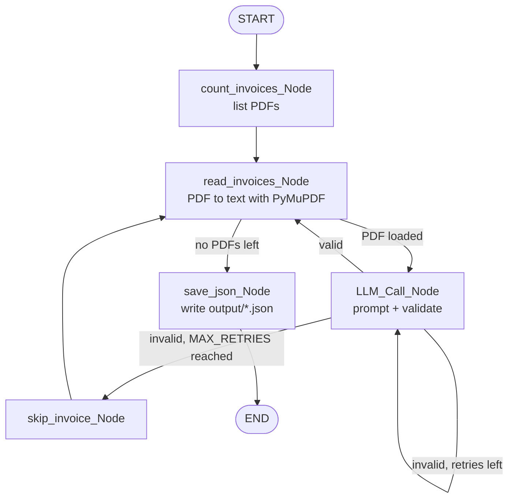

# Structured LLM Prompt Pipeline & JSON Extractor

Extracts structured data from messy, unstructured PDF invoices and turns it into **strictly validated JSON**, using an LLM, parameterized prompt templates, Pydantic schema validation and a self-correcting LangGraph retry loop.

> Datheon Internship · Python + Generative AI & LangChain · Task 1

---

## What it does

Invoice PDFs come in many layouts. When you extract their text, it is often messy: letters are spaced out (`S t u d i o`), labels sit far away from their values, and table columns get glued together. This project:

1. Reads every PDF in `some_demo_invoices/`
2. Sends the text to an LLM with a schema-driven prompt
3. Validates the LLM's answer against a strict Pydantic schema, including **arithmetic checks**
4. If validation fails, sends the exact errors back to the LLM and asks it to fix them (up to `MAX_RETRIES`)
5. Saves every valid invoice as JSON in `output/`

## Pipeline



Each invoice gets its own retry budget. One bad invoice is skipped and the rest keep running.

## Key features

### Parameterized prompt templates (`prompt.py`)

| Template | Parameters | Purpose |
|---|---|---|
| `SYSTEM_PROMPT` | `{schema}`, `{example}` | Output rules, rules for reading messy PDF text, a self-check list, and a few-shot example |
| `USER_PROMPT` | `{file_name}`, `{invoice_text}` | The invoice to extract |
| `RETRY_PROMPT` | `{previous_output}`, `{errors}` | Asks the model to fix only what failed validation |

The JSON Schema in the system prompt is generated at runtime with `Invice_Infos.model_json_schema()`. That way the prompt and the validator always agree on the field names.

### Strict validation (`main.py`)

- **`extra="forbid"`** on every model rejects any field the schema does not define, including renamed or invented ones
- **Typed fields:** ISO dates (`date`), 3-letter currency codes (regex), non-negative amounts, at least one line item
- **Arithmetic validators** that catch extraction mistakes:
  - `quantity × unit_price == amount` for every line item
  - `sum(line items) == subtotal`
  - `subtotal + tax_amount == total`
- **LLM-readable error messages.** Each validator explains what is wrong and how to fix it, for example:
  ```
  - line_items.0: Value error, line 'Poster': quantity (500.0) x unit_price (1.0) = 500.0,
    but amount is 100.0. Re-check which number is the quantity and which is the price.
  ```

### Self-correcting retry loop

When validation fails, the model sees the conversation as `system → user (invoice) → assistant (its wrong JSON) → user (validation errors)`. It fixes its own mistakes, which works better than starting over from scratch.

## Design decisions

- **Validators check extraction errors, not document errors.** Some real invoices are wrong themselves. For example, one sample prints `Tax (6%)` as `$36` on a `$450` subtotal. If the validator checked the tax *rate*, the loop could never pass. So only the arithmetic that must hold for a correct extraction is enforced.
- **Invoice numbers are strings.** This keeps leading zeros (`"01234"`).
- **Output files are named after the PDF, not the invoice number.** Two sample invoices share the number `12345` and two share `01234`.
- **`seller`, `due_date` and `payment_info` are optional.** Not every invoice has them, and the model must return `null` rather than invent data.

## Project structure

```
.
├── main.py                 # Pydantic schema, validators, LangGraph pipeline
├── prompt.py               # System / user / retry prompt templates + few-shot example
├── some_demo_invoices/     # Input PDFs (6 different layouts)
├── output/                 # Generated JSON (one file per invoice + all_invoices.json)
└── .env                    # API key and settings (not committed)
```

## Setup

**Requirements:** Python 3.10+ and an [OpenRouter](https://openrouter.ai/keys) API key.

```bash
pip install langgraph pydantic pymupdf openrouter python-dotenv
```

Create a `.env` file in the project folder:

```env
OPENROUTER_API_KEY=sk-or-v1-...
MAX_RETRIES=3
LLM_MAX_TOKENS=4096
LLM_TIMEOUT_SECONDS=60
```

## Run

```bash
python main.py
```

Every PDF in `some_demo_invoices/` is processed, and the results are written to `output/`.

## Sample output

`output/Red White and Black Modern Business Invoice.json`

```json
{
  "inv_num": "123456",
  "inv_date": "2030-05-24",
  "due_date": null,
  "currency": "USD",
  "seller": {
    "name": "Studio Shodwe",
    "address": "123 Anywhere St., Any City, ST 12345",
    "phone": "+123-456-7890",
    "email": "hello@reallygreatsite.com"
  },
  "bill_to": {
    "name": "Rachel Beaudry",
    "address": "123 Anywhere St., Any City, ST 12345",
    "phone": "+123-456-7890",
    "email": "hello@reallygreatsite.com"
  },
  "line_items": [
    { "description": "Service 1", "quantity": 1.0, "unit_price": 100.0, "amount": 100.0 },
    { "description": "Service 2", "quantity": 1.0, "unit_price": 150.0, "amount": 150.0 },
    { "description": "Service 3", "quantity": 1.0, "unit_price": 200.0, "amount": 200.0 }
  ],
  "subtotal": 450.0,
  "tax_rate_percent": 6.0,
  "tax_amount": 36.0,
  "total": 486.0,
  "payment_info": {
    "bank_name": "Borcelle Bank",
    "account_name": "Studio Shodwe",
    "account_number": "1234567890"
  },
  "notes": "Payment is due within 15 days of receiving this invoice."
}
```

## Tech stack

| | |
|---|---|
| LLM access | OpenRouter Python SDK (`nvidia/nemotron-3.5-lightning:free`, `temperature=0`) |
| Orchestration | LangGraph `StateGraph` with a Pydantic state |
| Validation | Pydantic v2 (`field_validator`, `model_validator`, `extra="forbid"`) |
| PDF to text | PyMuPDF (`get_text("text", sort=True)` keeps the reading order) |
